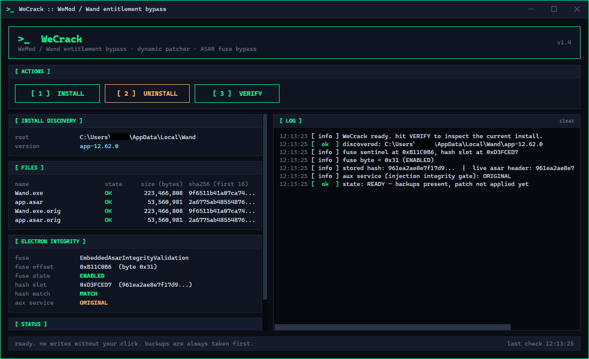

# WeCrack

**Get WeMod Pro for free.**
WeCrack is a small Windows app. It turns on every WeMod Pro feature and removes the 2 hour daily limit, without paying for a subscription.



---

## What it does

- **No more 2 hour timer.** Free WeMod only lets you use cheats for two hours a day. WeCrack removes that limit.
- **All Pro features unlocked.** Pro-only cheats, Pro themes, the Pro badge on your profile, and no upgrade popups.
- **No ads.** The ad panel and the "Remove ads with Wand Pro" banner are gone.
- **Mods still load.** Newer WeMod versions try to block edited copies of the app. WeCrack handles that so your trainers still start and your cheats still work.
- **Easy to undo.** It makes a backup of every file before it changes anything. One click puts everything back.

---

## How to use it

1. **Download** `WeCrack.exe` from the [Releases](../../releases) page.
2. **Close WeMod** if it is open.
3. **Double click** `WeCrack.exe`.
4. Click the green **`[ 1 ] INSTALL`** button.
5. Open WeMod. You now have Pro.

That is it.

### To undo everything

Open `WeCrack.exe` again and click **`[ 2 ] UNINSTALL`**. Your original WeMod files come back exactly as they were.

---

## The three buttons

| Button | What it does |
| --- | --- |
| **`[ 1 ] INSTALL`** | Turns on Pro. Backs up every file first. |
| **`[ 2 ] UNINSTALL`** | Puts the backups back. Undoes everything. |
| **`[ 3 ] VERIFY`** | Just looks. Tells you the current state of your install and changes nothing. |

## What the status colors mean

| Status | Color | Meaning | What to do |
| --- | --- | --- | --- |
| **CLEAN** | cyan | Never changed, nothing to undo | Click INSTALL |
| **READY** | cyan | Backups exist, but Pro is not applied yet | Click INSTALL |
| **PATCHED** | green | Pro is on and working | Nothing, enjoy |
| **MIXED** | red | Files look out of sync | Check the file list in the app |

---

## FAQ

**Is it safe?**
Yes. WeCrack only edits WeMod's own files. It saves a backup of each one before touching it, and it can put everything back with one click.

**Does WeMod have to be closed?**
Yes. The tool will not run while WeMod is open, because Windows will not let anything change a file that is in use.

**What happens when WeMod updates itself?**
The changes stop working on the new version. Just open WeCrack again and click INSTALL. It finds the new files on its own and applies everything again.

**Do I need administrator rights?**
No. WeCrack only touches files in your own user folder (`%LocalAppData%\Wand`).

**Will WeMod's servers know?**
No. Everything happens on your own computer. Nothing is sent anywhere. You still sign in with your normal free account.

**Why is my antivirus flagging it?**
Some antivirus programs flag any small unsigned tool that edits another program. WeCrack is open source, so every line of code is right here in this repository. If your antivirus blocks it, add an exception or [build it yourself](#build-from-source).

**Does it work on the latest WeMod version?**
Almost always. WeCrack finds what it needs by shape, not by exact file name, so it keeps working through WeMod's frequent updates. WeMod sometimes adds new protection to stop edited apps from loading mods, and WeCrack keeps up with that too. If a new version ever breaks it, open an issue.

**What if WeCrack cannot find WeMod on my PC?**
It shows **NOT FOUND** in the STATUS card and a `[ Browse for WeMod folder... ]` button. Click it and point at your WeMod install (the folder that holds the `app-XX.YY.Z` subfolders, usually `C:\Users\<you>\AppData\Local\Wand`). WeCrack remembers it next time. It also checks the Windows registry on its own, so most unusual install locations work with no extra steps.

---

## How it works (short version)

WeMod is an Electron app, which is basically a web browser packaged with a big file called `app.asar` that holds all its code. WeCrack does a few things:

1. Opens `app.asar` and finds the code that decides "is this user Pro?", then rewrites it to always say **yes**.
2. Finds the 2 hour timer and turns it **off**.
3. Unlocks the Pro **themes**.
4. Hides the **ads** and the "remove ads" banner.
5. Updates a small checksum stored inside `Wand.exe` so WeMod still accepts the edited `app.asar` and loads it normally.
6. On newer WeMod versions, edits the small helper program that loads mods into your game. That helper started refusing to run for edited copies of WeMod, and this step turns that check off so your cheats still work.

Every step is reversible. The original files are saved with a `.orig` name right next to them, and UNINSTALL copies them back.

---

## Build from source

You need [Visual Studio 2026](https://visualstudio.microsoft.com/) or the [.NET 10 SDK](https://dotnet.microsoft.com/download).

```bash
git clone https://github.com/luckyman-01/WeCrack.git
cd WeCrack
dotnet publish -c Release
```

The finished `WeCrack.exe` lands in the `Build\` folder. It is a single file with nothing else to install.

---

## Project layout

```
WeCrack\
  WeCrack.sln              solution file (open this in Visual Studio)
  README.md                you are here
  Build\
    WeCrack.exe            the finished app: one file, about 65 MB, no extra downloads
  WeCrack\                 source code
    App.xaml               theme (colors, fonts, button and scrollbar styles)
    MainWindow.xaml        the window you see
    MainWindow.xaml.cs     button clicks, log output, window frame
    CrackService.cs        the install, uninstall, and verify steps
    AsarArchive.cs         reads and writes Electron .asar files
    Patches.cs             the code edits (found by shape, so they survive WeMod updates)
    WandInstall.cs         finds your WeMod install and updates the stored checksum
    ServicePatch.cs        turns off the mod-loader check on newer WeMod versions
    Config.cs              saves your browsed install path to %LocalAppData%\WeCrack\config.json
    app.manifest           sharp text on high resolution screens
    resources\
      icon.ico             app icon (taskbar, alt-tab, Explorer)
      app.png              the screenshot at the top of this README
```

---

## License

Do whatever you want with this. It comes as-is, with no warranty.
